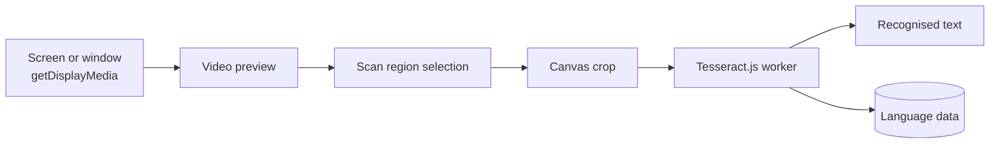

# TextLens

Browser-only OCR for your screen. Pick a monitor or window, preview it live,
drag to choose the area you care about, and extract the text. Recognition runs
in the browser and the image never leaves it.

Live demo: https://pixytech.github.io/TextLens/

Part of the Pixytech app family, listed at https://portal.pixytech.com

## Features

- Live preview of a chosen monitor or window using screen capture.
- Drag on the feed to restrict the scan area.
- Text extraction with Tesseract (LSTM engine) and automatic page
  segmentation.
- Selectable recognition language. The engine reloads when the language
  changes.
- Engine loading progress and recognition status.

## Architecture

### Overview



### Components

- **MonitorView** (`src/views/MonitorView.tsx`): the whole app. It owns the
  capture stream, the region selection overlay, the OCR worker and the
  output panel.
- **Capture**: `navigator.mediaDevices.getDisplayMedia` provides the live
  stream, shown in a video element.
- **Region selection**: a drag on the preview defines a rectangle. Only that
  rectangle is copied to a canvas for recognition, which is faster and more
  accurate than scanning the whole screen.
- **OCR worker**: Tesseract.js creates a worker with the LSTM-only engine and
  automatic page segmentation. Calling `recognize` on the cropped canvas
  returns the text.
- **Engine loader**: loads the worker and language data when the app opens and
  whenever the language changes, reporting progress as it goes.

### Design decisions

- Recognition runs on the cropped region, not the full frame, to keep scans
  quick and reduce noise from the rest of the screen.
- The engine is loaded eagerly so the first scan does not wait for a
  download.
- Tesseract runs in its own worker so the live preview stays smooth.

### Privacy

Screen content is processed locally and is never uploaded. The only network
requests are for the Tesseract engine and language data on first use.

### Limits

- Screen capture needs user permission each session and a secure context.
- Accuracy drops on small, low-contrast, skewed or handwritten text.
- Language data is downloaded the first time a language is used.

## Develop

```
npm install
npm run dev
npm run build
```

## Deploy

Pushing to `main` runs `.github/workflows/deploy.yml`, which builds the app and
publishes it to GitHub Pages. In the repository settings, set Pages source to
GitHub Actions. The Vite `base` in `vite.config.ts` must match the repository
name.

`portal.json` lets the Pixytech portal list this app.

## Licence

MIT. See LICENSE.
